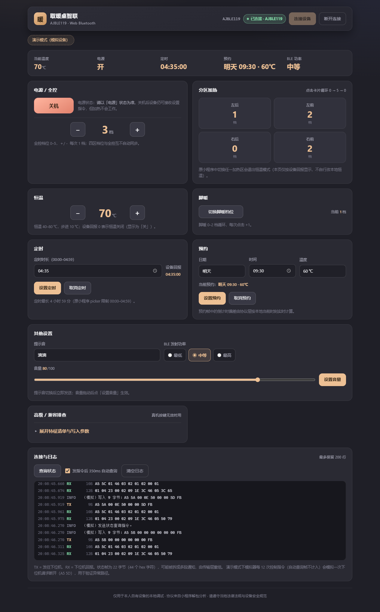

# AJBLE119 电暖桌控制（网页端 + Home Assistant）

**把「AJBLE119 / 取暖桌智联」电暖桌接进浏览器与 Home Assistant：网页端用 Web Bluetooth 直连，或 ESP32 刷 ESPHome 当 BLE 网关。**

> **适用范围**：**炉先生 电暖桌 D3 款**，或用「智联微控」连接、且蓝牙名称为 `AJBLE119` 的电暖桌；其它型号协议不同，按下文三步自查。

- **[`web/`](web/README.md)** —— 纯静态网页，Chrome/Edge 直连控制与读状态，零安装零后端
- **[`esphome/`](esphome/README.md)** —— ESP32 刷 ESPHome 当 BLE 网关，接入 HA（27 个自建实体）
- **[`docs/protocol.md`](docs/protocol.md)** —— 帧格式、命令字、状态位域、预约算法，协议唯一事实来源

## 最短路径

| 路径 | 步 | 动作 |
|---|---|---|
| **A 网页端** | 1 | `cd web` |
| | 2 | `python serve.py` |
| | 3 | 打开 <http://localhost:8000/>；无硬件加 `?mock=1` |
| **B HA** | 1 | 按 [esphome/README.md](esphome/README.md) 装 ESPHome |
| | 2 | 手机蓝牙 App 抄下 MAC、Notify、Write 三个特征 |
| | 3 | 复制 `secrets.yaml.example` 为 `secrets.yaml` 填 WiFi；替换 YAML 顶部三个占位符，换板子改 `variant` |
| | 4 | 刷入 `heating-table-single.yaml`，HA 自动出现 27 个实体 |

> 网页端需要支持 Web Bluetooth 的浏览器：桌面 Chrome / Edge、Android Chrome；iOS 全系不支持。

## 界面

<p></p>

*演示模式（`?mock=1`）截图；连真机后界面相同，只有数值和特征名不同。*

## 目录结构

```
.
├── README.md                     # 入口：能力 / 最短路径 / 连接参数 / 限制
├── docs/                         # 协议文档 + 小程序截图
│   ├── protocol.md               #    协议单一事实来源（帧格式 + 逐帧示例）
│   └── miniprogram-*.jpg         #    小程序图标与账号页
├── web/                          # ① 网页控制端（Web Bluetooth）
│   ├── index.html · css/ · js/   #    界面、样式、protocol/ble/mock/app
│   ├── test/ · serve.py          #    单元测试、本地静态服务器
│   └── README.md                 #    运行、真机连接、排障
└── esphome/                      # ② ESP32 固件（ESPHome → HA）
    ├── heating-table-single.yaml #    固件（零 includes）
    ├── HA卡片示例.md · docs/     #    仪表盘 YAML、取参数截图
    └── README.md                 #    安装、刷机、实体表、排障
```

## 设备与连接

| 项 | 值 |
|---|---|
| 广播名 | `AJBLE119`（精确匹配，区分大小写） |
| 服务 UUID | `EDFEC62E-9910-0BAC-5241-D8BDA6932A2F` |
| 通知特征 | `0783b03e-8535-b5a0-7140-a304d2495cb8`（`characteristicId[0]`） |
| 写入特征 | `0783b03e-8535-b5a0-7140-a304d2495cba`（`characteristicId[1]`） |
| MAC | 形如 `AE:07:3E:FC:CC:2A`；随机静态地址，上电后可能变化，用手机 App 现扫 |

> 为什么：小程序不读型号，只按广播名精确匹配；特征按枚举顺序固定取：第 0 个通知、第 1 个写入。

## 协议

帧格式、命令字表、22 字节状态位域与预约 `dayOff` 算法见 **[docs/protocol.md](docs/protocol.md)**，本页不复制表格。

## 已知限制

| 限制 | 说明 |
|---|---|
| 仅 AJBLE119 | 同厂 AJBLE04/07/12/29/68/233/301/349 等协议不同，判定见下节 |
| 网关限 ESP32 | `ble_client` / `esp32_ble_tracker` 为 ESP32 专属，ESP8266/RP2040 等无 BLE 中央栈 |
| 单链路 | 手机小程序与 ESP32 网关不能同时连接 |
| 定时限开机 | 关机时设备静默忽略定时指令；预约不受限 |
| 状态有延迟 | 写指令后等下一帧回传（≤10 s）才刷新，显示以设备为准 |

## 适用范围

**炉先生 电暖桌 D3 款**，或用「智联微控」小程序控制、且蓝牙名称为 `AJBLE119` 的电暖桌。拿不准就现场三步验证：

1. 广播名精确等于 `AJBLE119`。
2. 用网页端或蓝牙 App 发一帧查询帧（见 [docs/protocol.md](docs/protocol.md)）。
3. 收到 44 hex、以 `A5 5C` 开头 → 适用；收到 `A5 5D …` → 同族但命令字不同，需单独逆向；无回包 → 特征选错或非本设备。

## 来源

原厂控制端是微信小程序 **智联微控**（开发者：广州安聚物联网科技有限公司，标语「智慧物联，无需配网，方便快捷」）。

<p>
  
  
</p>

协议取自该小程序 `pages/AJBLE119/` 的静态分析，不涉及账号、云端接口或加密绕过。

## 免责

仅用于自己拥有设备的互操作研究：让自家桌子能被浏览器和 HA 控制。协议来自公开分发小程序的静态分析，未破解加密、未绕过授权或云服务；请勿用于他人设备或商业用途，作者不对设备损坏、数据丢失或保修失效负责。

## 参考

- [ESPHome ble_client](https://esphome.io/components/ble_client/)
- [ESPHome BLE 通知 sensor](https://esphome.io/components/sensor/ble_client/)
- [Web Bluetooth API](https://developer.mozilla.org/docs/Web/API/Web_Bluetooth_API)
- [web/README.md](web/README.md) · [esphome/README.md](esphome/README.md)
