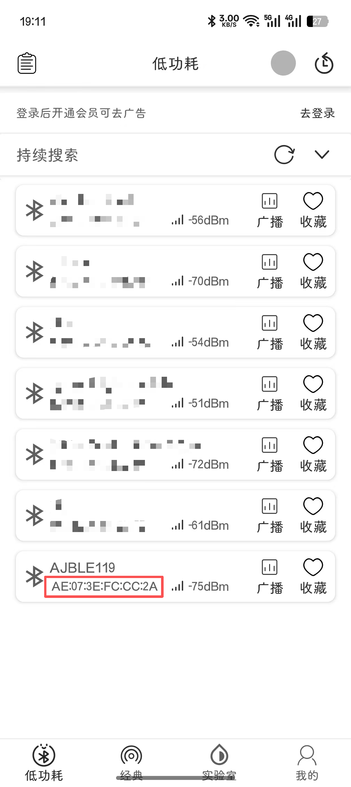
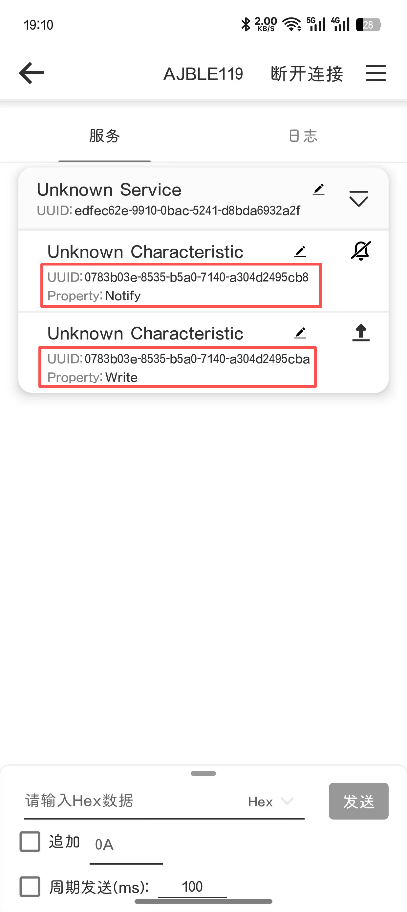

# ESP32 固件 · 刷写与接入 HA

## 1. 这是什么

一块**带 WiFi + BLE 的 ESP32**（经典款 / S3 / C3 / C6…，Flash ≥ 4MB）当 BLE 主机，直连电暖桌（广播名 `AJBLE119`，即 **炉先生 D3 款** 或「智联微控」里同型桌子），把 22 字节状态帧解析成 HA 实体，可用卡片/自动化控制。

> **一块 ESP32 当 BLE 网关，本地直连，不经厂商云端。**

本目录是[网页控制端及 HA 接入教程](../README.md)的固件部分；只想用浏览器控桌看 [web/](../web/README.md)。固件只有一个 [`heating-table-single.yaml`](heating-table-single.yaml)。

## 2. 三步上手

| 步骤 | 做什么 | 去哪 |
| --- | --- | --- |
| ① 拿 3 个参数 | 手机蓝牙 App 扫桌子 MAC、Notify、Write 三个值 | §3 |
| ② 填参数 | `secrets.yaml` 两行 WiFi + YAML 顶部三个占位符 | §4 |
| ③ 刷机接 HA | `esphome run` → ESPHome 集成 → 27 个实体 | §4、§5 |

> 一个 YAML = 一块板子。多块板复制多份即可；HA 的 ESPHome 插件里 NEW DEVICE 可建任意多个。

## 3. 拿 3 个参数

需要 **MAC / Notify / Write** 三个值。装任意能看 GATT 的手机 App（nRF Connect、LightBlue 均可）。

> ⚠️ 截图用「e调试」只是举例，不是推荐：界面含广告与付费会员入口，任何能看 GATT 的 App 操作都一样。

1. App 切「低功耗」(BLE) → 桌子通电待机 → 扫描列表找广播名 **`AJBLE119`**，记下 MAC（形如 `AE:07:3E:FC:CC:2A`）。



*图中红框为广播名 AJBLE119 与其 MAC。*

2. 点 `AJBLE119` 连接 → 「服务」页展开 `edfec62e-9910-0bac-5241-d8bda6932a2f` → 看两条特征的 `Property`：

| UUID 尾号 | Property | 方向 | 填到 |
| --- | --- | --- | --- |
| `…5cb8` | Notify | 设备 → 你 | `chr_notify` |
| `…5cba` | Write | 你 → 设备 | `chr_write` |



*图中红框为 Notify 与 Write 两条特征。*

3. 用 App 的 Hex 发送框自测两帧（先订阅 Notify 那条特征看回包）：

```
# 开机帧：桌子"滴"一声并亮屏 = 写入链路正常
A5 5A 00 00 00 00 00 FF FB

# 查询帧：回 44 个十六进制字符（22 字节）、以 A5 5C 开头
A5 5B 00 00 00 00 00 00 FB
```

> `AE` 开头是随机静态地址，部分桌子每次上电会变，连不上先重扫 MAC。`svc_uuid` 不用改。
> 也可用 [web/](../web/README.md) 连一次桌子，日志会打印 MAC 与服务/特征。

## 4. 填参数与刷机

```bash
cd esphome
cp secrets.yaml.example secrets.yaml      # 填 WiFi 两行：wifi_ssid / wifi_password（必须 2.4GHz）
# 填 secrets.yaml 的 api_key / ota_pw，再改 YAML 顶部 substitutions 三个占位符：
#   ble_mac / chr_notify / chr_write ← 换成 §3 的真值（不换会报 MAC 格式错误）
esphome config heating-table-single.yaml  # 先校验，秒级不编译
esphome run heating-table-single.yaml     # 编译 + 刷写；首次必须 USB，之后可 OTA
```

`api_key` 点 HA 的 ESPHome 插件里的 **Generate encryption key**，或本机 PowerShell 生成：

```powershell
[Convert]::ToBase64String((1..32 | % { Get-Random -Max 256 }))
```

> 为什么首次必须 USB：BLE 组件要改分区，官方要求先刷一次。
> 没装 ESPHome：HA → 设置 → 加载项商店 → 装 **ESPHome Device Builder** → NEW DEVICE，把 YAML 全文粘进去再 INSTALL。

## 5. 接进 HA

1. HA → 设置 → 设备与服务 → `+ 添加集成` → **ESPHome** → 主机填日志里的 IP（或 `heating-table.local`）→ 端口 `6053` → 粘 `api_key`。
2. 设备下出现 **27 个自建实体**（另有 1 个内部通知 `text_sensor` 不暴露；有区域前缀或改名后 id 会变，以 HA 界面为准）；固件里的 `text_sensor` 在 HA 落 **`sensor` 域**。

| 类型 | 实体后缀 | 说明 |
| --- | --- | --- |
| switch | `power` | 电源 |
| select | `temp` `level` `lf` `lb` `rf` `rb` `foot` `sound` | 温度 关/30–80℃；全控与四区档 0–5；脚暖 0–2；提示音 0/1/2 |
| number | `volume` | 音量 0–100 |
| sensor | `cur` `blepwr` `rx` | 当前温度 / BLE 功率档 / 已收状态帧数 |
| binary_sensor | `link` | BLE 连接状态 |
| button | `refresh` | 立即查询一次状态 |
| number | `orderday` `orderhour` `ordermin` `ordertemp` `timerhour` `timermin` | 预约/定时参数，仅本地暂存 |
| button | `applyorder` `cancelorder` `applytimer` `canceltimer` | 下发/取消预约、定时 |
| sensor（text_sensor） | `timer` `order` | 定时/预约只读回显 |

3. **预约/定时**：先填好参数（`orderday` 0=关/1=今天/2=明天，`timerhour/timermin` 是倒计时时长），再点 `applyorder` / `applytimer` 才真正下发；**定时仅开机有效**，预约不受限。
4. 固件已用子设备 `dev_timer` 把定时/预约的 12 个实体分到「电暖桌 定时预约」，刷完设备页与自动概览自动分成两块；只想改界面不刷机看 [HA卡片示例.md](HA卡片示例.md)。

## 6. 排障

| 症状 | 原因 | 动作 |
| --- | --- | --- |
| 日志没有 `Service UUID` / 连不上 | MAC 错、桌子没通电、被手机占线 | App 重扫 MAC（§3）；关小程序/网页；桌子断电 10s 再试 |
| 一直匹配不到 `AJBLE119` | MAC 变了（`AE` 是随机静态地址） | 重扫当前 MAC，改 `ble_mac` 重刷（§4） |
| 连上但状态不刷新 | `chr_notify` 填错 | 核对 `…5cb8` 那条（§3） |
| 状态刷新但按键没反应 | `chr_write` 填错 | 核对 `…5cba` 那条（§3） |
| 日志里没有 `TX(` 行 | 命令没进发送链：未连接，或发送脚本还没跑 | 先确认上一行有 `电暖桌已连接`，再点一次 |
| HA 实体明显偏少（如 17/18 个） | 板子里还是旧固件 | 确认改的是同一份 YAML，再 OTA 重刷 |
| 编译报 MAC 格式错误 | 三个占位符没换 | 按 §4 替换 `ble_mac/chr_notify/chr_write` |
| 编译报 `Duplicate … ASCII ID: '____'` | 实体名纯中文撞名 | 用带 ASCII 后缀的名字（本仓库已修好） |
| 刷不进 / 刷完 `invalid header` | 没进下载模式 / Flash 为空 | 按住 BOOT 再点刷写；首次走 USB（§4）；反复失败见 §8 |

BLE 连接日志对照（连上时必有前三行，本固件另打一行"电暖桌已连接"）：

| 日志 | 含义 |
| --- | --- |
| `… 0x01 Connecting` | 扫到广播，开始连 |
| `Connection open` | 链路建立 |
| `Service discovery complete` | 找到服务/特征 |
| 完全没有 `[esp32_ble_client]` 行 | 一次都没扫到目标（最常见：MAC 变了或被手机占线） |

## 7. 板子边界

**ESP32 家族 + WiFi + BLE + Flash ≥ 4MB** 都能跑，只改 `variant` 一行；本固件不碰 GPIO，代码无需改动。`variant` 与实物不符会刷不进去（§8 可救回）。

| `variant` | 无线 | 本固件 |
| --- | --- | --- |
| `esp32` `esp32s3` `esp32c2` `esp32c3` `esp32c5` `esp32c6` `esp32c61` | WiFi + BLE | ✅ 可用（C2/C3/C6/C61 单核需共存配置） |
| `esp32s2` | 只有 WiFi | ❌ 无蓝牙 |
| `esp32h2` `esp32h4` `esp32h21` | 只有 BLE | ❌ 无 WiFi，没法上报 HA |
| `esp32p4` | 无无线 | ❌ 要外挂协处理器 |
| ESP8266 / RP2040 / nRF52 / BK72xx | 视型号 | ❌ 非 ESP32 家族，没有 BLE 中央设备栈 |

单核芯片（C2/C3/C6/C61）WiFi 与 BLE 同核，加下面 3 行让扫描只在 HA 连上时开：

```yaml
esp32_ble_tracker:
  scan_parameters:
    continuous: false
```

> 完整写法还要在 `api:` 下用 `on_client_connected` 启动扫描（见官方 esp32_ble_tracker 文档）；双核板别加。
> 一个 ESP32 最多连 **3 个** BLE 设备；BLE 栈吃 RAM，别在同一块板上再叠语音/音频。2MB Flash 放不下 OTA 双分区，建议 4MB。

## 8. 回滚救砖

- 想回滚：`esphome run 上一版.yaml`（USB），或 OTA 刷回旧固件。
- 刷坏/不开机：先全片擦除（会清 NVS/WiFi 配置），再按 §4 USB 重刷：`python -m esptool --chip esp32 --port COM3 erase_flash`（按实物换 `--chip` 与端口）。
- 刷错芯片型号也能救回来，但先确认 `variant` 与实物一致（§7）。

---

> 校验声明：`heating-table-single.yaml` 按 ESPHome 官方文档逐字段手写，作者本机未完整编译；首次请先跑 `esphome config`（§4）。
> 协议帧格式、命令字与状态位域见 [docs/protocol.md](../docs/protocol.md)，本文不重复协议表。
