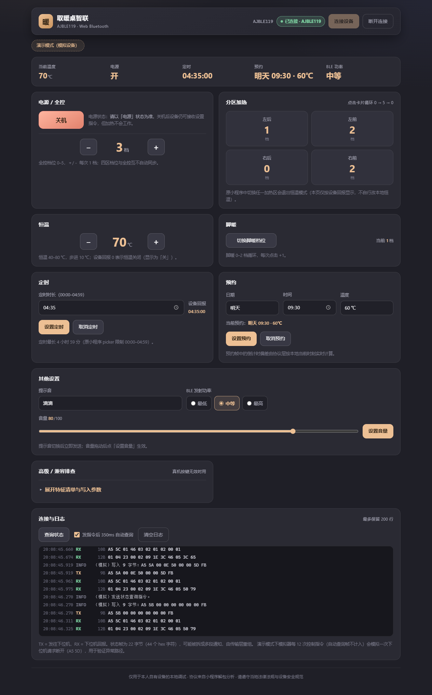
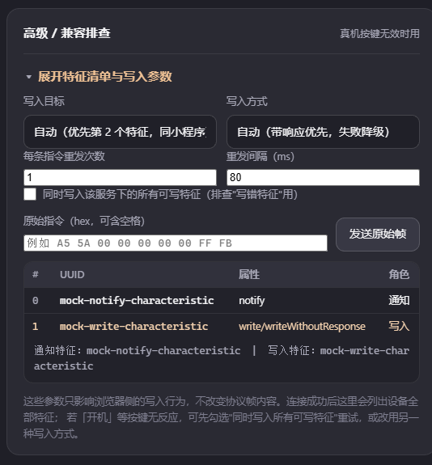

# web/ · 网页控制端（Web Bluetooth）

> 仓库总览见 [根 README](../README.md)，HA 接入见 [esphome/README.md](../esphome/README.md)，帧格式见 [协议参考](../docs/protocol.md)。
>
> 适用设备：**炉先生 电暖桌 D3 款**，或用「智联微控」连接、蓝牙名称为 `AJBLE119` 的电暖桌。



*图：连上设备后的主界面（演示模式）——顶部状态概览，中间电源 / 分区 / 恒温 / 定时 / 预约，底部收发日志。*

## 1. 这是什么

纯静态网页，零依赖、零后端：浏览器用 Web Bluetooth 直连广播名为 `AJBLE119` 的取暖桌，替代原微信小程序遥控。协议来自小程序解包分析，不涉及云端或账号。

- **浏览器直连 BLE**：连接、断开、收发都在页面本地完成，不经手机 App 或服务器。
- **实时读 22 字节状态回报**：电源、当前温度、定时、预约、四区档位、音量等全部回显。
- **高级 / 兼容排查面板**：能连上却按不动时，逐个换写特征、写方式、重发与 fanout，定位写通道。

## 2. 三步跑起来

```bash
cd web
python serve.py                 # 默认 8000；被占用则自动试 8001–8010
# 浏览器打开终端打印的地址：http://localhost:8000/
```

1. 页面顶部确认「真机模式」，点「连接设备」。
2. 在浏览器弹窗中选择广播名精确为 `AJBLE119` 的设备。
3. 连接后自动查询一次状态；操作控件即发送控制帧，发完约 350 ms 自动再查一次。

演示模式：`http://localhost:8000/?mock=1` 用本地模拟设备，无硬件也能点通全部交互（浏览器不支持 Web Bluetooth 时页面会自动降级到它）。
不能用 `file://` 双击打开：ES module 会被 CORS 拦住，且 Web Bluetooth 只在 HTTPS / `localhost` 安全上下文中可用。

## 3. 浏览器要求

| 平台 | 浏览器 | 必须条件 |
|---|---|---|
| Windows 10 / 11 | 桌面版 Chrome / Edge | 系统蓝牙已打开，并允许浏览器使用蓝牙 |
| macOS / Linux | 桌面版 Chrome | 适配器可用；本项目主要在 Windows 验证 |
| 手机 | Android Chrome | 能连，但页面按桌面布局设计，未做触摸适配 |
| 其它 | Firefox / Safari | 不支持 Web Bluetooth，只能进入演示模式 |

> 页面必须通过 `http://localhost:<port>/` 访问；`localhost` 属于安全上下文，不需要 HTTPS 证书。

## 4. 真机连接与控件

点「连接设备」→ 选 `AJBLE119` → 页面自动完成 GATT 连接、订阅通知、发查询帧。未连接时控件全部禁用。

| 控件 | 发什么帧 | 作用 |
|---|---|---|
| 电源 | 9B 控制帧 `0x0000`，p3=0 开 / 1 关 | 开关机，按钮文字随回报状态切换 |
| 恒温 ＋ / － | `0x0001`，p3=温度 | 40–80 ℃、步进 10；回报 0 显示「关」 |
| 全控 ＋ / － | `0x0002`，p3=0–5 | 整体加热档位增减 |
| 四区卡片（左前 / 左后 / 右前 / 右后） | `0x0005` / `0x0006` / `0x0003` / `0x0004` | 点击循环 0 → 5 → 0 档 |
| 脚暖 | `0x0007`，p3=0–2 | 点击循环 0 → 2 档 |
| 定时 / 取消定时 | `0x000A`，p2=时 p3=分；取消为固定帧 | 最长 04:59，取消发固定帧 |
| 预约 / 取消预约 | 15B `0x5E` 帧；取消为固定帧 | 今天 / 明天 + 时刻 + 40/50/60/70/80 ℃ |
| 提示音 / 音量 | `0x0009`；`0x000E`（音量值在 p1） | 静音 / 滴滴 / 语音；音量 0–100 滑块 + 设置 |
| BLE 功率 | `0x000D`，p3=1/5/9 | 最低 / 中等 / 最高发射功率 |

> 22 字节状态帧可能被拆成多段 BLE 通知，传输层会自动缓冲重组；命令字、校验、状态位域、预约倒计时算法全部见 [协议参考](../docs/protocol.md)。

## 5. 高级 / 兼容排查

真机「能连上、能读状态，但按键没反应」时展开此面板。参数只影响浏览器侧写入行为，不改帧内容。



*图：展开后的高级 / 兼容排查面板（演示模式，特征名是模拟值；真机会列出实际 UUID、属性与角色）。*

- **写入目标**：默认自动选第 2 个特征（同小程序）；可手动换成其它特征索引再试。
- **写入方式**：自动（带响应优先，失败降级）/ 只用带响应 / 只用无响应 / 旧版 writeValue。
- **重发次数与间隔**：每条指令重发 1–10 次、间隔 0–1000 ms，排除首包丢失。
- **同时写入所有可写特征（fanout）**：一次试出到底哪个特征才是命令通道。
- **发送原始帧**：直接发 hex，如开机帧 `A5 5A 00 00 00 00 00 FF FB`，排除上层拼帧问题。
- **特征清单**：连接后列出全部特征、属性与当前选中的通知 / 写特征。

> 建议顺序：看特征清单 → 换写入目标 → 勾 fanout → 换写入方式 → 加重发。

## 6. 常见问题

| 症状 | 原因 | 动作 |
|---|---|---|
| 弹窗里搜不到 `AJBLE119` | 桌子未通电、电脑蓝牙关闭、被手机小程序占用 | 确认通电与蓝牙，断开手机端后重试 |
| 连上但一直没有状态 | 通知未订阅成功或设备未回报 | 点「查询状态」发查询帧，看日志有无 RX |
| 日志出现 `A5 5D …` 后自动断开 | 下位机主动请求断开（固定帧） | 设备侧行为，重新点「连接设备」 |
| 能连、能读状态，但按键无效 | 写特征或写入方式不对 | 按第 5 节逐项排查 |
| 状态帧总是两段到达 | 22 B 超过单次通知载荷，被拆包 | 传输层自动重组，无需处理 |
| 页面空白 / 按钮没反应 | 用 `file://` 打开，ES module 加载失败 | 改用 `python serve.py` 走 `http://localhost` |
| 端口 8000 打不开 | 端口被占用 | 以终端打印的 8001–8010 地址为准 |

## 7. 免责与自测

仅限本人自有设备的本地调试与协议研究，不得用于他人设备；协议基于小程序解包，固件差异可能导致个别指令无效，作者不担责。

自测（Node 18+）：`cd web && node test/protocol.test.mjs && node test/ble.test.mjs`
